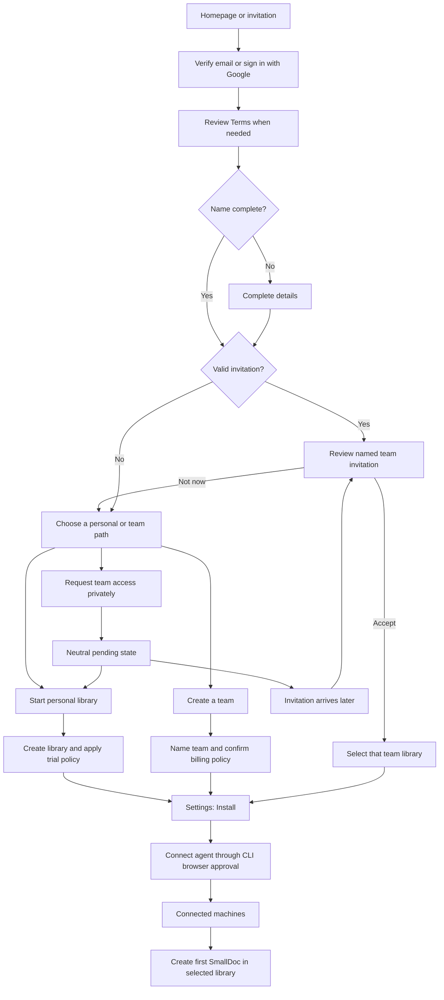
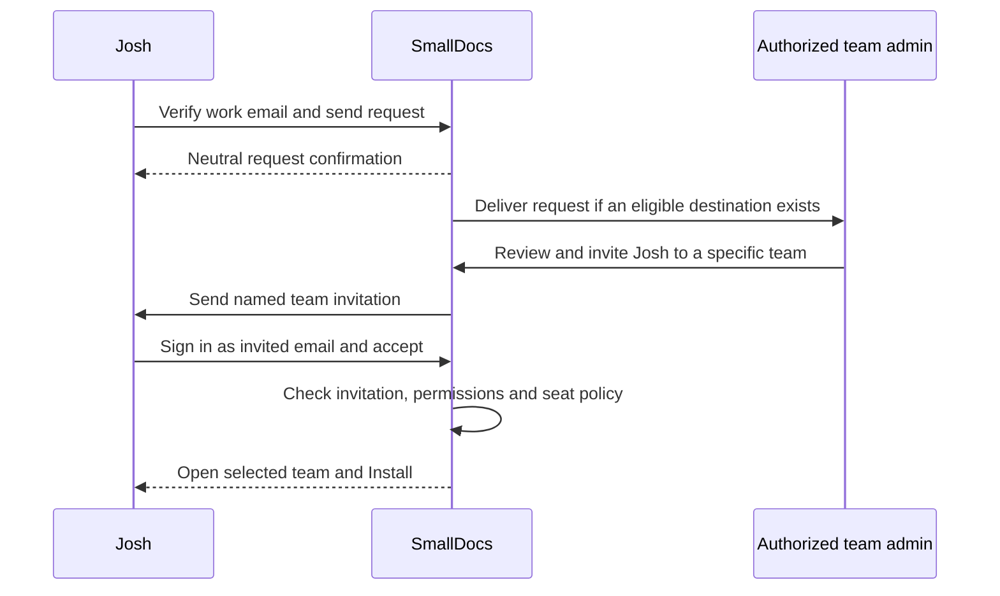
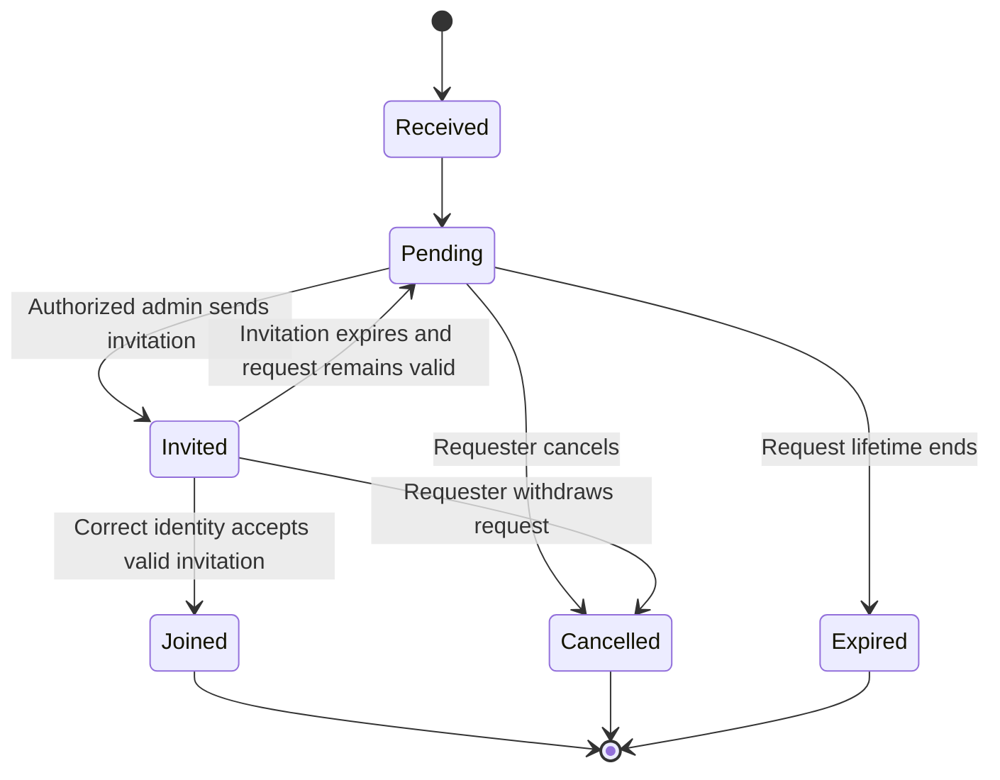

# SmallDocs Cloud onboarding and joining a team

Product journey map and implementation brief. Prepared 15 October 2026.

**The intended experience:** prove your email, complete your name if needed, choose where your documents will live, and connect your agent. A person can own a personal library and belong to several teams. A company email address can help route a request, but it does not grant membership or control of other people's libraries.

**The privacy direction agreed in our conversation:** someone verifying `josh@joes.com` should not be shown other users' names or a directory of teams. We can offer a neutral request action without confirming whether anyone at `joes.com` uses SmallDocs.

**Status:** a planning document, not a description of a completed release. The local onboarding implementation covers details capture and an Install tab. Personal trial creation and private domain requests are not implemented. Recommendations below remain proposals unless marked agreed. This document supersedes the earlier suggestion in `verified-email-team-discovery.md` to show discoverable team names.

## 1. The product model, without putting the model in the user's way

| Concept | What it means | What the user should experience |
| --- | --- | --- |
| Person | A user identity with verified sign-in methods and a name | Their name and email in settings |
| Personal library | A private workspace owned by that person | A ready place to save their own documents |
| Team library | A workspace with owners, admins, members and access rules | A named team in the account selector |
| Machine connection | CLI credentials belonging to the person | One machine entry in Connected machines |
| Save destination | The library selected for a particular Cloud operation | A clear choice when more than one library is available |
| Join request | An expression of interest in team access | Pending until someone explicitly invites them |
| Invitation | An offer to join a specific team, addressed to a verified email | The team name, the invited role and an accept action |
| Verified domain | Evidence of control of a domain, such as a DNS challenge | Eligibility to configure a domain request destination, if we introduce that feature |

The account box already present in settings is the library/account selector. A personal account can be named after its owner, which makes it look like a user profile. It is still a library selection control.

**Recommended visible header:** name and verified email beneath “Cloud settings”, plus the existing account selector at the right once a library exists. On mobile, retain the current stacked settings layout. The selector switches the library; it does not switch the signed-in person.

A brand-new person should not normally encounter a long-lived state with a sign-in but no usable library. The current local preview has that state because workspace and trial creation remain unfinished. Decide whether to create the personal library immediately or only after the person's destination choice. Do not mistake the preview gap for the desired final product.

## 2. What is agreed, proposed and still open

### Agreed direction

- Onboarding belongs in the account/library environment, not back in the marketing homepage.
- Settings should have an Install tab with both prompt and manual instructions.
- Reuse Connected machines. Do not create a second independent connection model.
- Capture missing names; use Google profile details where available.
- Do not expose names or team existence through company-domain discovery.
- Owning a team does not make Bob administrator of everyone at his email domain.
- SmallDocs is moving toward Cloud-first use, with a free month intended for new users.

### Recommendations in this document

- An existing invitation takes priority over generic onboarding.
- A domain request ends in an invitation to a specific team, then acceptance.
- Offer a personal library while a team request is pending.
- Keep personal and team content separate when joining or switching libraries.
- Start with invitations and an administrator handoff link; introduce domain routing once its recipient policy is decided.

### Decisions not yet made

When the personal trial begins; whether every team joiner needs a personal library; who receives a domain request; whether domain ownership proof is required for receiving requests; seat charges; notification frequency; expiry periods; and how sign-in methods are linked.

These are product choices for review. No new production restrictions or policies are being introduced by this document.

## 3. The complete journey

Returning users with a usable library should skip completed onboarding. A returning user following an invitation still reviews that invitation. A returning user clicking “Get install prompt” should land on Install rather than being sent through profile collection again.

## 4. Journey variants at a glance

| Variant | First useful screen after authentication | Library outcome | Next action |
| --- | --- | --- | --- |
| A. New Gmail user, Google supplies name | Destination choice | Personal by default, subject to decision | Start library, then Install |
| B. New email user | Your details | None until destination is resolved | Enter name, then choose |
| C. Google supplies incomplete name | Your details, prefilled where supported | Same as B | Complete missing details |
| D. New work-email user, no invitation | Neutral team/personal choice | Personal or pending request | Request access or continue personally |
| E. Request routing has no eligible recipient | Same neutral request confirmation | No membership | Wait, copy handoff link or start personally |
| F. Eligible team receives request | Same neutral request confirmation | No membership yet | Admin reviews privately |
| G. Several eligible teams exist | Same neutral request confirmation | No automatic selection | Resolve through explicit invitations |
| H. Existing invitation | Invitation for a named team | That team after acceptance | Install or Open library |
| I. Invitation is for another email | Identity mismatch screen | No change | Switch or verify the invited email |
| J. Returning personal user | Library or Install, depending on entry point | Existing personal library | Continue without a new trial |
| K. Existing team member | Existing team library or Install | Existing memberships | Connect another machine if needed |
| L. Person belongs to multiple libraries | Existing account selector | No new library needed | Explicitly select destination |
| M. Personal user later joins a team | Named invitation | Keeps personal and gains team access | Choose where future saves go |
| N. User creates a team | Team name and commercial setup | New team owned by creator | Invite others, then Install |
| O. User already has CLI credentials | Install with link to Connected machines | Unchanged | Reuse or add connection |
| P. CLI runs on a remote machine | Browser authorization handoff | Unchanged | Approve that named machine |
| Q. User leaves or is removed from team | Remaining libraries or account choice | Team access removed | Choose a valid destination |
| R. Google/email sign-in refer to same email | Sign-in-method resolution | Must preserve correct identity | Explicit account linking where required |

## 5. Personal signup and details capture

### A. Google supplies a usable name

Google authenticates the person. Our callback verifies the token and receives the available profile fields. If the account has no saved name, use the supplied given and family names. Preserve names already saved by the user.

If their details are complete, skip the details form. Show their name and email in settings. A Google display name is a useful profile value, not evidence of employment, team authority or legal identity.

**Current branch limitation:** the callback only prefills when both given and family names are present. A partial profile falls back to the details form rather than failing sign-in. We can improve partial prefilling separately.

### B. Email verification, then name

The person enters their email on the homepage. The current branch sends them to the existing sign-in page with that email prefilled. They request and enter a six-digit code, then accept Terms when necessary, then complete their name.

Suggested details screen:

> **Your details**
>
> josh@joes.com
>
> First name: Josh
>
> Last name: [input]
>
> **Continue**

The verified email is displayed, not silently editable as part of a name update. Changing email is a separate verification flow. If we later replace the code with an emailed install link, successfully redeeming that link can supply email proof. Merely sending it cannot.

**Open question:** the existing model requires first and last name. Decide whether to retain that or support a single full-name field, including people with one name. This document does not change the current requirement.

### C. Details already saved

Skip the form when the necessary profile values already exist. Do not make a returning user confirm unchanged names on every install. Settings should eventually provide an explicit way to edit their name.

### Proposed destination choice

For a new person without an invitation, use a small, focused choice before Install:

> **Where will you use SmallDocs?**
>
> **Start my library**
>
> **Request to join a team at joes.com**
>
> **Create a team**

The domain option is generated from their verified eligible work-email domain. Its presence must not depend on whether a matching team exists. For Gmail and similar shared providers, omit company-domain routing and offer a team invitation/request link instead.

If this choice feels like too much onboarding, an alternative is to create the personal library first and show “Join or create a team” as a secondary action on Install. The trade-off is more personal workspaces and possibly more trials for people who only intend to join a team.

## 6. Josh requests access at joes.com

### What Josh should and should not learn

After verifying his work email, Josh can express interest in joining a team. Before an explicit invitation, he does not see Bob's name, email, team name, member count or activity. He also does not receive an answer about whether anyone at the company uses SmallDocs.

Suggested request screen:

> **Request to join a team at joes.com**
>
> Your request can be shared with team admins eligible to receive requests for this domain. It includes your name, verified email and any note you add.
>
> Anything else? (optional)
>
> **Send request**
>
> [Start my own library]

Suggested confirmation in all successful submission cases:

> **Request received**
>
> We'll email you if a team invites you.
>
> [Start my library] [Copy request link]

“Request received” confirms our receipt, not delivery to an administrator. Avoid “Bob has been notified”, “Your company already uses SmallDocs”, “No matching team”, or a recipient count.

### D. No eligible team exists

Store the request with the same visible pending state. Do not invent a recipient or promise a reply. Offer the handoff link and personal use.

Decide whether a request may be routed if an eligible team is configured later. A privacy-conscious first version would require a new request or fresh consent rather than silently sharing an old person's details with a newly established recipient.

### E. One eligible team exists

Queue delivery to its authorized request reviewers. Josh still sees the generic confirmation. The reviewer sees Josh's supplied name, verified work email and optional note, because Josh agreed to share those with the eligible reviewers.

The admin chooses whether to invite Josh. Receipt of a request neither creates membership nor reserves a paid seat.

### F. Multiple eligible teams exist

This is the hardest part of the design. We cannot privately name teams for Josh to choose, and sending his details to every matching team expands disclosure and produces competing invitations.

| Routing option | Benefit | Cost |
| --- | --- | --- |
| Administrator handoff link | Josh chooses who receives the link outside SmallDocs | Requires him to know a colleague or admin |
| One domain request destination | Predictable recipient and one review queue | Needs domain control verification, recipient administration and recovery |
| All opted-in, eligible teams | Higher chance someone can help | More people receive Josh's details; duplicates and conflicting invitations |

**Recommendation:** ship the handoff link first. If we ship automatic domain routing, use an explicitly configured domain intake destination rather than silently broadcasting to all same-domain team creators. That destination can issue an invitation to a specific team it administers. It does not gain control over any other team.

This recommendation narrows the routing design, not the user's available memberships. Multiple independent teams at the same company remain valid.

If we choose fan-out instead, the consent text must accurately describe the recipients, and the invitation acceptance screen must make the selected destination clear. Do not hide the routing trade-off behind a generic button.

### G. Josh sends the handoff link to Bob

The link identifies a request, not a membership grant. Bob signs in. He can review it only as an authorized admin for a team that is eligible for that request, or through an explicitly designed invitation workflow.

If Bob manages multiple teams, he chooses the destination himself. Josh has not been shown those teams. A normal member cannot use the request link to grant themselves admin powers. An unrelated person opening the link does not receive Josh's full profile by default.

After Bob issues an invitation, Josh reviews it. Forwarding or merely fetching the link must not add anyone to a team. Decide request-link expiry, revocation and whether the link itself carries any limited viewing permission before building it.

## 7. From request to invitation to membership

The visible team name is disclosed at the invitation step by an authorized team admin. This is a deliberate disclosure to a particular verified person, not a searchable directory.

Suggested invitation screen:

> **You're invited to Joe's engineering**
>
> josh@joes.com
>
> Role: Member
>
> [Accept invitation] [Not now]

Display inviter identity only if that is a deliberate invitation design choice. The private domain-request screen does not need it.

### H. Direct invitation already exists

Honor the invitation entry point through authentication, Terms and name completion. Return to the invitation, not a generic personal-library signup. Accepting it should select the team in settings.

The new profile page currently has a fixed Install destination. Before extending it to team invitations, preserve a validated continuation for the invitation token. Otherwise completing a name can lose the original task.

### I. Wrong email is signed in

Say that the invitation requires the email it was addressed to. Offer switching or verifying that email. Do not transfer the invitation to whichever account happens to be signed in. Avoid exposing the full invited address to a person who only possesses a forwarded link unless the invitation design deliberately permits that disclosure.

### J. Expired, revoked, declined or duplicate invitation

Give an actionable state without granting access: request a replacement, return to existing libraries, or resume a pending request. If the person already belongs to the team, show Open library rather than billing or adding membership again.

### K. Admin approves but the user never accepts

Prefer “Invited” rather than “Joined”. The intended first version creates or reuses an invitation. Seat billing and membership should follow the chosen acceptance policy, not the act of sending a request. The current interface already says a billed seat is added after acceptance; preserve consistency or deliberately update it everywhere.

## 8. Bob's authority and domain control

Bob owns the team he creates. That lets him manage that team's members and settings. It does not let him discover every colleague, inspect independent libraries, seize existing teams, or prevent someone at joes.com creating another team.

There are three different proofs:

| Proof | What it establishes | What it does not establish |
| --- | --- | --- |
| Email code or suitable Google identity | Control of an identity or mailbox under the chosen verification policy | Authority over the whole company |
| Admin membership in a SmallDocs team | Authority to manage that team's permitted actions | Ownership of the email domain |
| DNS domain challenge | Control of a domain's DNS at verification time | Ownership of existing SmallDocs teams or their documents |

**Proposed use for DNS proof:** allow a designated person to configure where private requests for that domain are delivered. Domain intake authority must be scoped to that function. It must not rewrite team memberships or transfer document ownership.

Questions before building domain proof: can several teams claim the same domain; who selects or changes the intake destination; what happens when DNS control changes; how does an existing company recover intake control; and what notice is given when the recipient changes?

A Google Workspace domain claim can be an identity signal. It is not DNS ownership proof or permission to administer a SmallDocs team. Do not trust an `hd` request parameter or an email suffix alone as team authorization. [Google's OpenID Connect reference](https://developers.google.com/identity/openid-connect/reference)

Google also distinguishes Gmail/Workspace identities from Google accounts using third-party email addresses. For the latter, an old verified-email claim may not prove current mailbox ownership. Review fresh work-email verification before allowing company request routing in that case. This is a proposed joining-policy check, not a statement that the current callback already performs it. [Google backend authentication guidance](https://developers.google.com/identity/sign-in/android/backend-auth)

## 9. Personal libraries, teams and the free month

### L. Personal use while waiting

Josh can start a personal library while his request is pending. If he later joins Joe's engineering, his personal documents remain in his personal library. Joining does not copy, move or share them with Bob.

### M. Joining a team after starting personally

Keep both library choices in the selector. Select the invited team when he finishes accepting that invitation. Make the destination visible before his agent saves a document. Do not change every existing local document binding or machine-wide default merely because he joined a team.

### N. Already a team member

If Josh already has access, avoid a fresh request and show his existing team through the normal authenticated account selector. The privacy policy concerns information about other people and teams he has not been invited to; it should not conceal his own memberships from him.

### O. Multiple existing teams

Use the existing account selector. Respect an explicit destination in an invitation or document link. Otherwise use a valid saved selection, or ask him to choose. A team the user cannot access must not be selected from an arbitrary URL parameter.

### P. New team creator

Ask for the team name and explain the relevant commercial terms before any charge. Team creation grants control of the new team only. Receiving domain requests is an additional opt-in feature, not a side effect of using a company email.

### Trial decisions

| Decision | Recommended starting point | Why it needs explicit agreement |
| --- | --- | --- |
| Start event | First usable personal library provisioned | Starting on email entry can spend time before the person can use the product |
| Duration | Match the advertised “month” precisely | Calendar month and 30 days are different rules |
| Team request pending | No team seat charge | No membership has been accepted |
| Join a paid team | Apply the team's seat policy at acceptance | The team admin needs to understand the cost |
| Personal trial after joining | Keep its original end date; explain separate billing | Team access and personal entitlement are separate |
| Multiple sign-in methods | Avoid duplicate trials for the same linked person | Requires an explicit, safe identity-linking design |
| End of trial | Define read, export and write behaviour before shipping | Users need predictable access to their documents |

The personal-library provisioning operation should tolerate retries without creating duplicate libraries. Trial provisioning needs equivalent idempotency. The repository already has `ensurePersonalWorkspace`; the automatic one-month onboarding entitlement is still separate work. Existing Business trial invitations do not prove that the new self-serve personal trial is implemented.

## 10. Install and Connected machines

### The Install screen

Show the existing settings shell, verified email, name where available, and account selector when there is a selected library. Include:

1. Install with your agent: one copyable prompt.
2. Install manually: platform-appropriate commands with a copy action.
3. View connected machines: links to the existing tab.
4. Open library: opens the selected library, rather than silently changing accounts.

A prompt starts CLI installation and the existing browser approval flow. It must not contain a browser session cookie or a long-lived secret. If we later design a one-use bootstrap token, its scope, expiry, consumption and recovery deserve a separate design.

### Q. No machine connected

Use the current Connected machines empty state and `sdoc cloud login` guidance. Entering that tab refreshes the list. Returning from browser approval can refresh it again.

### R. Machine already connected

Show the existing credential entries. The person can reuse their machine or connect another. A row represents a CLI authorization, not a detected running agent. Multiple rows with the same hostname can be separate authorizations; do not quietly collapse or revoke them.

### S. Remote or headless agent

The agent initiates device authorization and gives the user a URL/code. The user completes approval in a browser. Avoid depending on localhost browser callbacks to the remote machine. The installed CLI's existing device flow is the mechanism to build on.

### T. Person belongs to multiple libraries

The CLI credential belongs to the person and can work with libraries they can access. The destination still needs selection. Use explicit account selection when ambiguous, and preserve stable document bindings on updates. Team membership or changing the browser selector alone should not silently move an existing document.

### U. Person is removed from a team

Their machine credential may remain valid for personal use and other teams. Team authorization checks must deny access to the removed team. The settings selector should remove inaccessible choices. Explain the problem and offer a valid destination without automatically recreating or publishing team content elsewhere.

## 11. The information-disclosure contract

| Moment | Josh can see | Eligible admin can see | Not disclosed by this step |
| --- | --- | --- | --- |
| Before email proof | Generic sign-in next step | Nothing from a join request | Whether Josh or joes.com uses SmallDocs |
| After proof, before request | His identity and generic domain action | Nothing yet | Other names, teams, member counts |
| After request | Received/pending state and his own note | Consented requester details if routed | Recipient names, delivery count, team existence |
| Explicit invitation | Invited team, proposed role and acceptance action | Invitation state | Other independent teams |
| After acceptance | His permitted team/library content | Normal membership details | Personal library content |
| After removal | His remaining authorized libraries | Team's audit/membership state | Ongoing access to the removed team's documents |

Generic wording alone is insufficient. API shape, status codes, recipient counts, timing, polling and email notifications can expose the same facts. Create the visible request record independently of recipient lookup and route it asynchronously. Do not claim perfectly constant response timing without testing it.

A pending state should not later change to “No team exists”. If there is no invitation, expiry should be neutral too. A delivery failure is not a reason to disclose recipient identity or whether there was a recipient.

OWASP recommends consistent responses for account-recovery flows to reduce account enumeration. Applying that principle to private team requests is a design inference here. It is not a claim that OWASP specifies this exact product flow. [OWASP authentication guidance](https://cheatsheetseries.owasp.org/cheatsheets/Authentication_Cheat_Sheet.html)

**Residual disclosure:** once an admin explicitly invites Josh, he learns that named team exists. If no invitation ever arrives, he may draw conclusions, but the product should not turn silence into an authoritative “company does not use SmallDocs” answer. DNS records themselves can also be publicly observable, depending on the verification method.

## 12. State transitions and failure cases

Internally, delivery, admin review and each invitation can have their own states. The requester-facing projection should not expose a team's internal decline or delivery details. If several teams may receive a request, one team's decline cannot terminate another team's invitation. Request withdrawal should stop future routing; define separately what happens to invitations already issued.

| Failure or edge case | Intended response |
| --- | --- |
| Email/code expired | Offer another verification attempt; preserve intended destination |
| Google permission denied | Offer email sign-in and retain the onboarding task |
| Profile name missing | Ask for it rather than rejecting a valid sign-in |
| Profile save fails | Preserve fields and offer retry |
| Duplicate request click | Reuse the pending request; do not notify admins twice |
| Shared-provider email | Use invitations or handoff links; no company-directory implication |
| Domain has subdomains or international characters | Define normalization and exact eligibility; do not use suffix substring matching |
| Requester changes email | Re-evaluate proof and routing; do not retain stale domain eligibility silently |
| Admin loses role before approval | Reject unauthorized action and preserve request consistency |
| Team closes or disables intake | Stop future delivery and invitation creation; keep requester response neutral |
| Team cannot add a seat | Give the admin the billing resolution; do not add partial membership |
| User accepts twice | Return existing membership without duplicate charges |
| User opens two signup tabs | Reuse profile and personal-library provisioning |
| Request link is forwarded | Require authorized review; link alone does not grant membership |
| Email security scanner visits a link | Fetching a URL alone does not accept Terms or join a team |
| Trial provisioning fails after identity exists | Offer retry; do not create another user or claim the library is ready |
| User belongs to a private team already | Show their own authorized team normally; do not make it discoverable to outsiders |

## 13. Existing code and implementation gaps

Based on the inspected branch and the production settings surface. Local changes are not assumed to be deployed.

| Capability | Current position | Work needed |
| --- | --- | --- |
| Email codes and browser sessions | Existing | Reuse, preserve intended return path |
| Google token verification | Existing; local profile-scope change added | Live-check additional consent and company-email proof policy |
| First/last name storage | Existing profile API | New details page uses it; refine single-name support if chosen |
| Terms acceptance | Existing | Preserve continuation through every path |
| Settings Install tab | Local implementation | Add selected-library context to final onboarding |
| Connected machines and revoke | Existing | Reused; refresh on tab entry and visibility return |
| Personal workspace creation | Existing `ensurePersonalWorkspace` | Invoke at the chosen onboarding point |
| Automatic personal free month | Not complete for this flow | Entitlement lifecycle, expiry and retries |
| Team invitations and roles | Existing | Preserve invitation through profile completion |
| Allowed invitation domains | Existing | Keep separate from domain ownership and request intake |
| Private domain request records | Not implemented | Recipient policy, storage, cancellation and neutral projection |
| DNS verification/intake authority | Not implemented | Verification, recipient changes and recovery |
| Admin request queue | Not implemented | Authorized review and invitation creation |
| Identity linking across Google/email | Existing model does not auto-merge by matching email | Design explicit linking and recovery before promising a single account |

Relevant source areas: `server.js`; `lib/cloud-auth.js`; `lib/cloud-oauth.js`; `lib/cloud-store.js`; `lib/cloud-billing.js` and billing lifecycle modules; `public/cloud-profile.*`; `public/cloud-admin.*`; `public/cloud-invite.*`; `public/cloud-business-invite.*`; `cli/lib/cloud-commands.js`.

### Proposed new data, not a finalized schema

- A domain intake policy: normalized domain, enabled state, verification reference, authorized review destination and who changed it.
- A join request: requester identity, verified-email snapshot, eligibility proof reference, consent record, optional note, timestamps and requester-visible state.
- A private routing record: request, eligible destination, delivery/review state and idempotency key. Never return this record wholesale to the requester.
- A request-link record: request reference, token digest, expiry and revocation state, with deliberately limited permissions.
- An invitation association: request, target team and existing invitation record, allowing retries and multiple invitations if the selected policy permits them.
- Audit events for intake changes, request routing and invitation decisions, excluding raw sign-in or handoff tokens.

Decide retention, expiry and access rules before adding these records. Suggested fields describe the required distinctions; they do not settle the policy.

## 14. Build order and acceptance criteria

### Increment 1: Finish personal onboarding

Complete identity, name, Terms, idempotent personal-library provisioning and the chosen free-month policy. Land on Install with the actual personal account box. Returning users skip completed steps. Test failures between each operation.

**Done when:** a new user can connect a machine, save a document to the provisioned library and reopen the same returned Cloud URL. UI-only success is not enough.

### Increment 2: Preserve direct team invitation journeys

After authentication and missing details, return to the original invitation. Accept once, apply the chosen seat policy, select the team and show Install or the library. Personal documents remain untouched.

**Done when:** new and returning users can join the intended team without accidentally creating a second personal trial or accepting as the wrong identity.

### Increment 3: Administrator request link

Create a private request that the verified user can send to someone they know. The authorized reviewer chooses a team and issues an ordinary invitation. Keep recipient disclosure and forwarding behaviour explicit.

**Done when:** forwarding the link to an unrelated user cannot reveal requester details or create membership; an authorized admin can complete the invitation path.

### Increment 4: Private domain intake

Only after choosing recipient governance, add the generic domain request action, eligible intake settings and background routing. Verify equivalent requester-facing outcomes with zero, one and multiple potential destinations.

**Done when:** request responses and polling do not provide a directory of company usage, while admins receive only requests they are authorized and opted in to review.

### Later options

Domain verification, automatic joining, company-managed organization structures, SSO lifecycle management and team consolidation. Each changes authority or disclosure and deserves an explicit decision. None should be smuggled into the initial request button.

## 15. Test matrix for review and implementation

| Test group | Required cases |
| --- | --- |
| Identity | Email code; Google with full, partial and absent names; cancelled Google flow; existing profile preserved |
| Continuation | Homepage; direct invitation; Install deep link; document link; Terms required; two tabs |
| Libraries | New personal; existing personal; one team; personal plus team; several teams; removed membership |
| Requests | Zero recipients; one; multiple; intake disabled; duplicate; cancel; expiry; recipient changes |
| Authorization | Wrong email; normal member reviews request; admin loses role; copied request token; forged domain |
| Invitations | Existing invite; expired; revoked; already accepted; declined; multiple invitations; team subscription blocked |
| Machines | None; existing; second machine; duplicate hostname; revoked; remote CLI; delayed token collection |
| Billing | Trial provisioning retry; no duplicate trial; seat acceptance; trial ends; failed payment; cancellation |
| Privacy | Public responses; authenticated response body; status polling; notification text; recipient counts; timing distributions |
| Layout/accessibility | Narrow phone; desktop; long names/emails; keyboard; screen-reader labels; loading/error states |

The local preview at `localhost:3102` currently covers details, Install and machine-list variants with fictional API data. It does not test real email delivery, team requests, trial creation or Google company-domain authority. Use it to review the page structure, not as evidence those backend paths are complete.

## 16. Decisions to settle before the next build

| # | Choice | Proposed starting point |
| --- | --- | --- |
| 1 | Create personal library before or after destination choice? | After choice, or immediately with a clearly secondary team action if we want fewer screens |
| 2 | First/last name or a single name? | Review the current requirement before extending it |
| 3 | Google name prefill or mandatory confirmation? | Prefill empty values and allow later editing |
| 4 | Does every team joiner get a personal trial? | Do not create one implicitly through an invitation |
| 5 | Is the domain request button independent of recipient existence? | Yes |
| 6 | What names are hidden before invitation? | Other people and undisclosed teams |
| 7 | Is matching email domain enough to receive requests as Bob? | No automatic recipient status from signup alone |
| 8 | Initial routing mechanism? | Administrator handoff link |
| 9 | If automatic routing is added, who receives requests? | Explicit domain intake destination, pending governance design |
| 10 | May requests be broadcast to multiple teams? | Defer; require accurate consent if adopted |
| 11 | Does approval directly add Josh? | Prefer invitation followed by Josh's acceptance |
| 12 | When does team seat billing occur? | Align with the existing invitation acceptance contract |
| 13 | What happens while Josh waits? | Optional personal library, no team access |
| 14 | Does joining move personal documents? | No; any move/share is an explicit separate action |
| 15 | Who controls an existing team after DNS verification? | Its existing authorized owners/admins |
| 16 | Can a domain controller see every team? | No implicit directory or takeover privilege |
| 17 | Are old requests routed to newly configured recipients? | Require a fresh request or renewed consent |
| 18 | What ends or cancels a request? | Define separate request and invitation lifetimes |
| 19 | How do Google and email accounts link? | Explicit authenticated linking, no silent email-only merge |
| 20 | What is the first end-to-end milestone? | New personal library, trial, connected CLI and first saved document |

**Recommended next implementation:** finish the personal-library/trial path and preserve direct invitations first. The neutral domain-request idea fits this structure, but its recipient governance should be agreed before creating a request queue or sending anyone's details to administrators.
