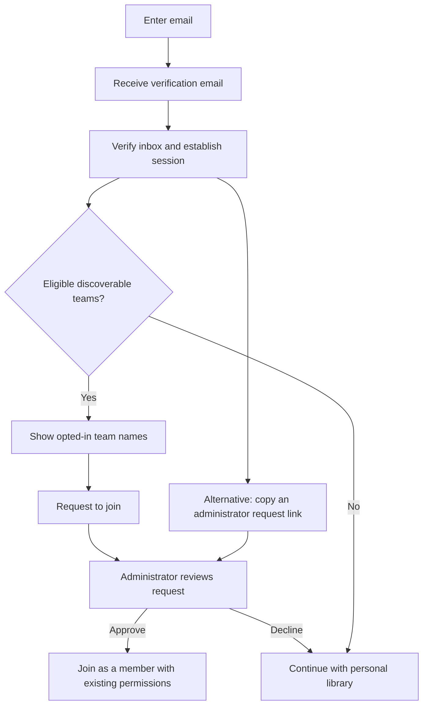

# Finding your team through verified work email

Build note for SmallDocs, 15 October 2026. Proposed behavior for later implementation, not a shipped feature or an approved final specification.

## Intended experience

Someone enters a work email, proves control of the inbox, and can find teams that have chosen to be discoverable to that domain. They request membership; an administrator approves it. They can continue using a personal library while waiting.

The core distinction is **email verification enables discovery; a team's policy determines membership; document permissions determine access**. None of these should silently imply the next.

The six-digit verification screen observed after entering `josh@fb.com` is consistent with this design, but does not prove how that particular service works. Showing a code screen should not disclose whether the address is registered or whether its employer uses the product.

## Proposed journey

### Before email verification

Accept an email and return a neutral next step such as “Check your email to continue.” Use equivalent public responses for a new address and an existing account. Team discovery must not be accessible through an unauthenticated domain lookup API, hidden page data, error codes, or analytics payloads.

Issue a random, expiring challenge tied to the address and purpose. Store a digest rather than the raw code/token. Consume it once, cap attempts and limit both sends and verification attempts. Rate limits should account for address and network abuse, with additional aggregate controls where appropriate. Avoid observable response differences that disclose registration state.

A six-digit code has a small guess space, so expiry alone is insufficient. Resends need a defined invalidation policy. Do not log codes or complete sign-in links.

An emailed onboarding link can perform this verification instead of a second code. Sending the email is not verification. If using a link, a mail scanner fetching the URL should not consume the challenge or grant membership; redeem through a deliberate continuation action.

### After email verification

Derive the domain from the authenticated user's verified identity on the server. Do not trust a `domain` or `email` supplied by the browser as proof of eligibility.

Return only teams that explicitly opted into discovery for that verified domain. Initially show the team's chosen display name and a Request to join action. Do not expose members, member counts, administrator email addresses, documents or activity.

This intentionally reveals an opted-in team's existence to people who control an eligible email address. It does not provide absolute company-usage secrecy. If that disclosure is unacceptable, use administrator request links only and omit discovery.

When there are no eligible results, say “No teams available to join.” This does not distinguish an absent team from a private team, a disabled domain or an unavailable discovery policy. Offer a personal library and the administrator-request alternative.

### Administrator review

Show the requester’s verified email, supplied name and optional note to the team's owner/admin. Approval should create membership through the existing authorization model, with a member role and explicit default project/group access. Domain eligibility must not grant an administrator role.

Recheck the administrator's current role, the request state and the current team policy at approval time. Decide whether approved domain eligibility is still required, or whether approval acts as an explicit invitation that may override it. Make repeat approvals idempotent and prevent concurrent actions from adding duplicate membership or billing twice.

Confirm the new workspace to the requester. Joining does not move personal documents or change the CLI's save destination without an explicit choice. Preserve the existing membership, project and document permission checks.

## Administrator settings

Recommended first version:

| Setting | Proposed behavior |
| --- | --- |
| Team discovery | Off until an owner/admin enables it |
| Eligible domains | Exact, explicitly configured company domains |
| Public email providers | No discovery based on Gmail, Outlook or other shared-provider domains |
| Joining | Administrator approval required |
| Public result | Chosen team name and Request to join |
| Team documents | Existing access rules apply after membership |
| Automatic joining | A possible later, explicit policy rather than the initial default |

An administrator having `person@abc.com` proves access to that mailbox, not authority over all of `abc.com`. Domain verification, such as a DNS challenge, is a recommended additional step before enabling discovery. This would be new work, distinct from entering an allowed invitation domain.

Define exact-domain and subdomain behavior explicitly. `abc.com` should not implicitly authorize `abc.com.attacker.example`, and a verified parent domain should not silently enable every subdomain. Normalize internationalized domain names and compare canonical domain values. Do not infer organizational identity from names that merely look similar.

Different teams may legitimately share a domain. Allow the product decision to support multiple opted-in teams rather than silently routing everyone to the first result. Domain ownership changes and employee departures also need a revocation path; an old verification must not grant permanent future eligibility.

## Alternative: send a link to your administrator

A verified requester can create a short-lived request link without discovering any teams. They send it to their administrator through their own communication channel.

The recipient signs into their own account, chooses a team they can administer, and reviews the verified requester before approval. The request link must not log the recipient in as the requester, reveal teams to an unauthenticated holder, or grant access merely by opening it.

This supports contractors and people using personal email providers. The administrator can invite an external address deliberately, even though it is ineligible for same-domain discovery.

The link is a request capability, not an invitation or sign-in credential. Make its state revocable and expiring. Restrict who can inspect requester details; possession alone should not reveal the requester's private account data. Add a confirmation step if an administrator attempts to approve a request into a different company/team than expected.

## What exists in the reviewed code

| Existing capability | Location | Reuse or gap |
| --- | --- | --- |
| One-use email codes, attempt limits, verified identities and sessions | `lib/cloud-auth.js`, `cloud/auth/http.js` | Reuse the identity proof and session boundary; an onboarding magic-link flow is separate work. |
| Personal/team workspaces and member roles | `lib/cloud-store.js` | Reuse membership and access checks. |
| Approved invitation domains | `getWorkspaceInvitePolicy`, `setWorkspaceInviteDomains` in `lib/cloud-store.js` | These configure who members may invite. They are not a domain-ownership verification or team-discovery feature. |
| Invitations | `createInvitation` in `lib/cloud-store.js` | Owner/admin invitations and policy-controlled member invitations already exist. Preserve role and project-grant checks. |
| Business invitation page | `public/cloud-business-invite.js` | Existing sign-in and invitation acceptance provide useful UI patterns. |

Review boundary: the homepage worktree was inspected locally. No live account or company membership was queried for this document.

## Proposed implementation shape

Keep identity, discovery policy and membership separate. Candidate records, to refine before building:

- **Verified domain claim:** domain, owning organization/team relationship, verification method/state and verification timestamp. Decide how shared domains and multiple teams are represented.
- **Team discovery policy:** team, enabled state, eligible verified domains and joining mode. Do not silently reinterpret existing invitation-domain settings.
- **Join request:** requester user ID, team ID when selected, pending/approved/declined/cancelled/expired state, created/expiry timestamps and optional note. Bind any administrator handoff token to this request through a stored digest.
- **Audit event:** actor, request/team IDs, action and timestamp. Exclude sign-in codes, raw capability links and document contents.

Conceptual API operations, not existing routes:

1. List eligible teams for the authenticated verified identity.
2. Create/cancel a join request, with duplicate-pending-request handling.
3. List pending requests for authorized administrators.
4. Approve/decline a request atomically and enforce existing seat/entitlement policy.
5. Create/revoke an administrator handoff link and resolve it only within an authorized review flow.

Use server-side authorization on every operation. The browser hiding a control is not an access check. Notification delivery should not create membership, and retrying a notification should not duplicate requests. Notify appropriate administrators without publishing their addresses to the requester.

## Decisions before implementation

1. **Discovery or request links only?** Discovery improves self-service but intentionally discloses opted-in team names to verified domain users.
2. **Who can enable a domain?** Recommend domain ownership verification; decide the administrator and recovery workflow.
3. **Approval or auto-join?** Recommend approval for the first version. If auto-join is added, define default document access and seat charges first.
4. **What happens to the personal trial?** Let the user work while waiting; decide trial and billing treatment when joining a paid team.
5. **Who pays for a new member?** Check paid-seat effects at approval and show the administrator the consequence.
6. **How long do proof and requests remain valid?** Set challenge, handoff-link, request and domain-reverification lifetimes independently.
7. **What happens after departure or domain changes?** Define removal, pending-request cancellation, SSO interaction and whether domain eligibility needs fresh verification.
8. **What is visible to administrators and requesters?** Document the exact disclosure before sending notifications or enabling discovery.

These are proposals for review, not new application restrictions implemented by this document.

## Acceptance checks for the later build

- Entering an unowned address reaches a neutral verification step and reveals no account/team existence.
- Valid verification resumes an existing identity rather than creating a duplicate account; changing the email cannot reuse the old proof.
- Expired, replayed and over-attempted challenges fail; send and resend abuse is controlled.
- Link-scanner fetches do not consume sign-in challenges or approve requests.
- Unverified API calls and forged domain parameters cannot enumerate teams.
- Verified users see only opted-in eligible teams; private teams remain undisclosed.
- Public-provider users can use explicit invitations and administrator handoff links, without domain-based discovery.
- Domain matching handles exact boundaries, case, subdomains and internationalized names.
- An administrator whose role was removed cannot approve; concurrent approval is idempotent.
- Membership creation respects paid seats and grants no unintended document or administrator access.
- Joining preserves personal documents and does not silently change the active CLI workspace.
- Expired, forwarded or revoked handoff links cannot impersonate the requester or expose a team directory.
- Domain-discovery revocation blocks subsequent discovery and follows the agreed policy for pending requests.
- Notifications and audit records contain no reusable authentication secrets.

## Sources

[OWASP email validation and verification guidance](https://cheatsheetseries.owasp.org/cheatsheets/Email_Validation_and_Verification_Cheat_Sheet.html) supports inbox verification, expiring one-use challenges, rate limiting and anti-enumeration behavior.

[OWASP authentication guidance](https://cheatsheetseries.owasp.org/cheatsheets/Authentication_Cheat_Sheet.html) covers generic responses and response discrepancies that can expose account existence.

[Atlassian approved-domain access settings](https://support.atlassian.com/user-management/docs/control-how-users-get-access-to-products/) illustrate administrator-controlled domain access and optional approval. [Atlassian domain verification](https://support.atlassian.com/user-management/docs/verify-a-domain-to-manage-accounts/) illustrates the separate proof of control over a domain. These references do not establish the internals of the signup screen observed in the conversation.
