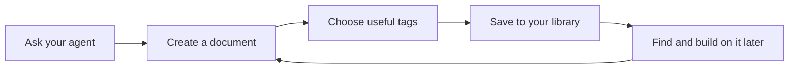

# Your SmallDocs library

SmallDocs builds a tagged knowledge base from the documents you ask your agent to make. Your agent chooses useful tags and reuses existing ones, so you can find and build on earlier work without organising files yourself.

Ask for a document in ordinary language: **"Write a document about our launch plan."** You can also say **"Make a SmallDoc"** or **"Use SmallDocs."** Your agent saves it to your library and gives you a link you can open on your computer or phone.

## Your Personal library and team libraries

Your **Personal** library is private to you. To work with other people, use **Create team library** in the library selector, or ask your agent to open that page. A team library has its own members. Inviting someone does not share documents you have kept private.

One subscription covers you across your libraries. You can ask your agent to explain your trial, invite a team member, or open subscription and cancellation settings. You complete payment and cancellation in the browser.

Cloud documents are encrypted in storage. SmallDocs decrypts them to serve readers and agents who have permission to access them.

## Find knowledge again

This document has `getting-started` and `smalldocs` tags. As your library grows, related tags connect documents from different conversations.

Try: **"Find our launch documents tagged research and summarise the decisions."** Your agent can also search by author, words, phrases and dates, within the documents you can access.



You can ask for diagrams like this to explain a process, a system or the relationships between ideas. Expand a diagram when you want more room to read it.

## Work with numbers

Here is a small project budget. The totals are calculated from the values in the sheet.

```cells Budget
Work,Hours,Rate,Cost
Research,4,60,=B2*C2
Writing,6,60,=B3*C3
Review,2,60,=B4*C4
Total,=SUM(B2:B4),,=SUM(D2:D4)
```

Select cells for statistics, expand the sheet to try different values, or download it as an Excel file with its formulas. Changes you make in the expanded scratch sheet do not change the saved document. Ask your agent when you want to update the saved version.

Try: **"Make a budget spreadsheet and show me where most of the cost goes."** A SmallDoc can contain several sheets and charts alongside the written explanation.

```chart
{"type":"bar","title":"Example project cost","labels":["Research","Writing","Review"],"values":[240,360,120],"format":"number"}
```

## Present an idea

Slides can live in the same document as your notes and supporting numbers. Use the presentation icon on a slide to open the deck.

~~~slide
@extends cover
#eyebrow: Your knowledge, connected
#title: Ask. Save. Find. Build.
#subtitle: A document library that grows with your work.
~~~

~~~slide
@extends two-column
#title: Start privately, collaborate when you choose
#left-header: Personal
#left:
- A private library for your own work
- Tags connect related documents
- Your agent can find and update them
#right-header: Team
#right:
- Create a separate library for a project or company
- Invite the people you work with
- Choose who can access each document
~~~

Try: **"Turn this report into five slides, keeping the supporting analysis underneath."**

## Explore an assumption

An interactive HTML and JavaScript component can let you change an input and see its effect. This example estimates how many working days a project needs at different daily allocations.

~~~sdoc-app
<!doctype html>
<html lang="en">
<head>
  <meta charset="utf-8">
  <meta name="viewport" content="width=device-width, initial-scale=1">
  <title>Project time explorer</title>
  <style>
    main { max-width: 36rem; }
    label { display: block; margin-top: 1rem; }
    input { width: 100%; margin-top: .5rem; }
    output { font-variant-numeric: tabular-nums; }
    #days { font-size: 1.5em; }
  </style>
</head>
<body>
  <main>
    <h3>How much time can you give the project?</h3>
    <p>The example project needs 12 hours. Change your daily allocation to compare the number of working days.</p>
    <label for="hours">Hours per day: <output id="hours-value">2</output></label>
    <input id="hours" type="range" min="1" max="6" step="1" value="2">
    <p aria-live="polite"><output id="days">6</output> working days</p>
  </main>
  <script>
    const hours = document.getElementById('hours');
    function update() {
      document.getElementById('hours-value').value = hours.value;
      document.getElementById('days').value = Math.ceil(12 / Number(hours.value));
    }
    hours.addEventListener('input', update);
    update();
  </script>
</body>
</html>
~~~

Try: **"Build an interactive tool so I can compare the assumptions in this plan."** Components can also open fullscreen, and run inside the document's sandbox.

## Give feedback and keep working

Switch to comment mode and select a passage, diagram element, spreadsheet cell or slide to leave feedback. Then ask your agent: **"Read my comments, update this document and clear the comments you've addressed."**

The agent can update the same document, keeping its link. An open browser page picks up saved changes. History shows who changed it and why, and lets you open an earlier revision as a new document.

## Three things to try next

1. **"Write a document about a topic I'm working on, and tag it so we can find it again."**
2. **"Find my related documents and turn the key ideas into a diagram and a short slide deck."**
3. **"Create a team library for our project and help me invite a colleague."**

Your agent can explain these features as you use them. The Learn menu also has prompts you can copy into your chat.
