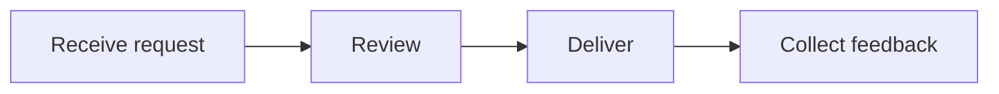
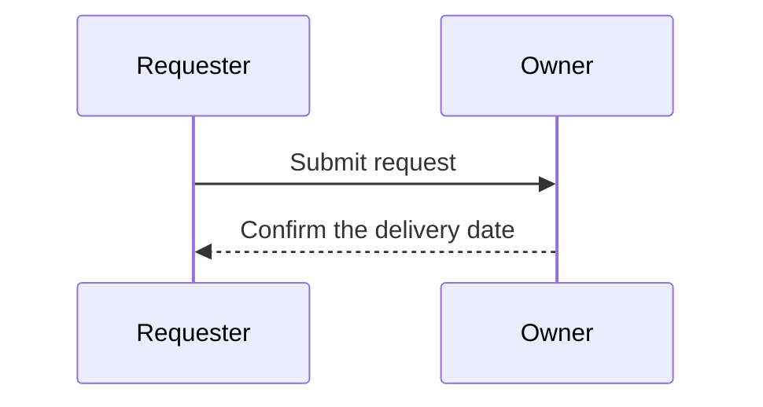

# Delivery plan and budget

The delivery team is preparing a staged launch. The budget, handover diagram and presentation describe the same plan from different angles.

## Budget

```cells Delivery/Budget
Team,Monthly allocation,People,Per person
Platform,1200,3,=B2/C2
Research,800,2,=B3/C3
Operations,600,2,=B4/C4
Total,=SUM(B2:B4),=SUM(C2:C4),=B5/C5
```

```cells Delivery/Summary
Measure,Value
Monthly allocation,=Budget!B5
People,=Budget!C5
```

The Platform allocation includes tooling and operational support. Changing an allocation should leave the headcount and formulas intact.

## Delivery sequence





## Readiness

| Service | Region | Status | Owner |
| --- | --- | --- | --- |
| API | Europe | Ready | Platform |
| API | America | Review | Operations |
| API v2 | Europe | Draft | Research |
| Importer | Europe | Check `input` and escaped \| values | Platform |

## Presentation

~~~slide
grid 100 56.25 bg=#ffffff
r 6 5 88 9 text=title | Delivery readiness
r 6 20 26 23 fill=#edf3fa radius=1 | ## Budget

  Keep allocations, headcount and calculated totals in one model.
r 37 20 26 23 fill=#eef5ed radius=1 | ## Review

  Confirm ownership before a request reaches delivery.
r 68 20 26 23 fill=#faf1e8 radius=1 | ## Follow-up

  Use feedback to improve the next handover.
~~~

~~~slide
grid 100 56.25 bg=#ffffff
r 6 6 88 10 text=title | Next decisions
r 8 23 84 22 | 1. Confirm the allocation.

  2. Name the reviewer.

  3. Agree the delivery date.
~~~

## Working notes

1. Preserve formulas when correcting a budget value.

   A feedback thread can refer to one cell, several selected rows, or a whole slide. Check its source context before changing the plan.

2. Keep the handover sequence and the presentation consistent.

   - A renamed diagram node keeps its logical ID.
   - A moved slide should keep feedback on the same element.

3. Close addressed feedback after checking the saved result.
