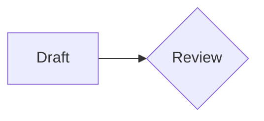
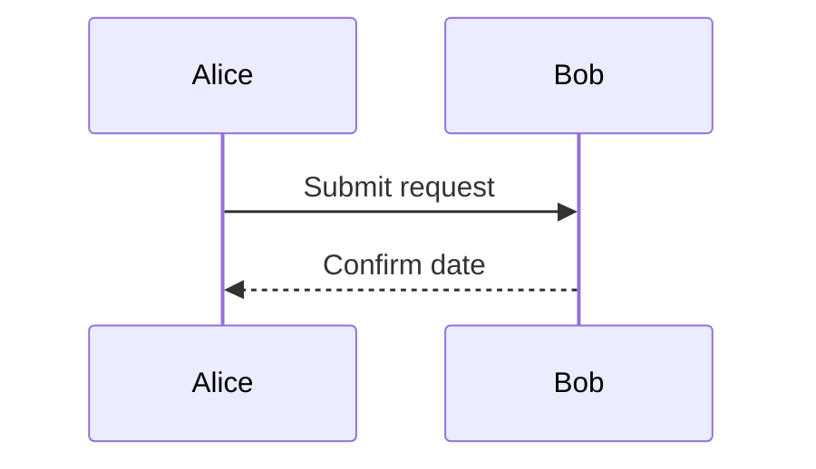

# Editable objects

7. Keep this item.
8. Keep this too.

```cells Budget/Costs
format: B=plain
Item,Amount
Hosting,100
Research,200
Total,=SUM(B2:B3)
```

```cells Budget/Summary
Measure,Value
Total,=Costs!B4
```

~~~slide
grid 100 56.25 bg=#ffffff
r 5 5 90 12 text=title | Delivery readiness
r 5 23 40 20 fill=#edf3fa | ## Budget
  Keep the **allocation** intact.
r 55 23 40 20 fill=#eef6ef | ## Review
  Confirm the reviewer.
~~~





An ordinary paragraph.
